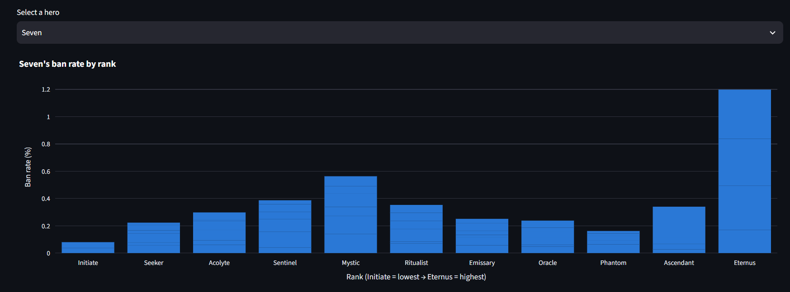
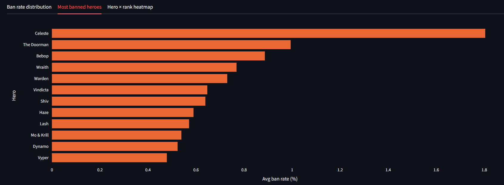

# Deadlock Hero Ban Rates Across Ranks

A Streamlit app exploring hero ban rates in [Deadlock](https://playdeadlock.com) (Valve's hero shooter/MOBA), broken down by rank.

## What it does

- Loads `deadlock_ban_rates.csv`
- Runs an initial EDA (shape, dtypes, missing values, summary statistics)
- Lets you pick a hero and see their ban rate across every rank, ordered from lowest (**Initiate**) to highest (**Eternus**)
- Includes supporting graphics: overall ban-rate distribution, most-banned heroes, and a hero × rank heatmap

## Data source

Pulled from [api.deadlock-api.com](https://api.deadlock-api.com/docs), a free public REST API for Deadlock match data, using:
- `GET /v1/analytics/hero-ban-stats` (bucketed by average match badge, i.e. rank) — ban counts per hero per rank
- `GET /v1/analytics/hero-stats` (same bucketing) — used to estimate total matches per rank bucket
- `GET /v1/assets/heroes` — hero ID → name lookup

**Ban rate** is computed as:

```
ban_rate_pct = bans_for_hero_in_rank / estimated_matches_in_rank * 100
```

`estimated_matches_in_rank` is approximated as the sum of every hero's match appearances in that rank bucket, divided by 12 (6v6 → 12 hero slots per match), since the API doesn't expose a direct "total matches per rank" figure. Rank buckets with fewer than 50 estimated matches were dropped as unreliable.

Run `uv run python fetch_data.py` to rebuild `deadlock_ban_rates.csv` from scratch with fresh data.

## Running locally

```bash
uv add streamlit pandas plotly requests   # already done, included for reference
uv run streamlit run app.py
```

Then open http://localhost:8501.

## Screenshots

**Hero ban rate by rank** — selecting "Seven" shows a clear spike at Eternus, the highest rank:



**Most banned heroes overall** — Celeste is banned far more often than any other hero:


